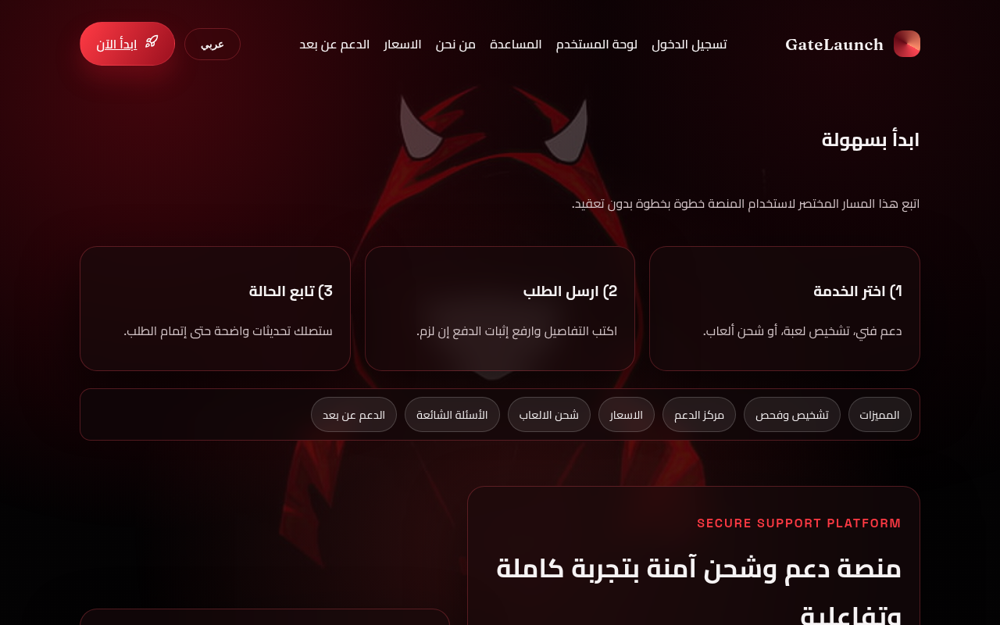

# GateLaunch

A demo web platform for support and game top-up requests (Arabic / English), built with Node.js, Express and SQLite.



*Screenshot: `landing.html` rendered locally, front end only. The backend was not running for this image.*

## What is in the repo

- Front-end pages: `landing.html`, `index.html`, `dashboard.html`, `admin.html`, `help.html`, `about.html`.
- Six payment-method pages: Vodafone, Orange, Etisalat, Fawry, InstaPay and Meeza (`payment-*.html`).
- `server.js`: an Express server with sign-up / login, tickets, orders, payment receipts, notifications and optional Telegram / n8n / AI-assistant integrations.
- `db.js` and `data.json`: storage layer (SQLite via `better-sqlite3`, or JSON file).
- `DATABASE_SETUP.md`, `PRODUCTION_CHECKLIST.md`, `QA_CHECKLIST.md`: the author's setup and check notes.

## Run locally

```
npm install
cp .env.example .env   # then fill in your own values
npm start
```

`npm run check` runs a syntax check on `server.js`, `app.js` and `db.js`.

## Limits

- This is a demo. The payment pages record receipts a user uploads; they do not process real payments.
- Only the landing page is shown above. The dashboard, admin and API behavior were not run for this README, so nothing here claims they work.
- Never commit `.env`. It is listed in `.gitignore`.
